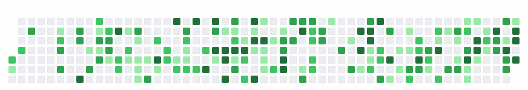

# GitHub Contribution Bomber 💣

GitHub 프로필의 잔디(Contribution Graph) 위를 픽셀 아트 봄버가 돌아다니며 폭탄을 설치하고, 십자 폭발로 잔디를 모두 날려버리는 **자동 플레이 애니메이션 SVG**를 생성합니다.
[Platane/snk](https://github.com/Platane/snk)의 "잔디 먹는 뱀"에서 영감을 받았고, 코드는 처음부터 새로 작성했습니다.



- 실제 Contribution 데이터로 게임판 생성 (7 × ~53, GitHub 색상 그대로)
- 경로 탐색 + 폭탄 위치 최적화로 **모든 잔디를 반드시 제거** (매 생성 시 시뮬레이션 검증)
- 폭탄 설치 → 안전지대로 대피 → 십자 폭발 → 잔디 파괴 → 승리 → 잔디 재생 → 무한 반복
- JavaScript 없이 SVG 자체(CSS 애니메이션)로 재생 → GitHub README ``에서 동작
- 라이트 / 다크 테마, GitHub Actions로 자동 갱신, 시드로 재현 가능

---

## 1. 프로필 README에 넣기 (5분)

**① 프로필 저장소**(사용자명과 같은 이름의 저장소, 예: `octocat/octocat`)에 워크플로 파일을 추가합니다.
[`examples/profile-workflow.yml`](examples/profile-workflow.yml)을 `.github/workflows/bomber.yml`로 복사하세요.

```yaml
name: Contribution bomber
on:
  schedule:
    - cron: "17 */12 * * *"   # 하루 두 번
  workflow_dispatch:          # Actions 탭의 "Run workflow" 버튼
permissions:
  contents: write             # output 브랜치에 결과물을 올릴 때만 필요
jobs:
  generate:
    runs-on: ubuntu-latest
    steps:
      - uses: BangJeongHyeok/github-grass-bomberman@main
        with:
          github_user_name: ${{ github.repository_owner }}
          outputs: |
            dist/github-bomber.svg
            dist/github-bomber-dark.svg?theme=dark
      - name: Publish to the output branch
        # (examples/profile-workflow.yml 참고: dist/ 를 output 브랜치로 push)
```

**② Actions 탭 → "Contribution bomber" → Run workflow**로 한 번 실행합니다. `output` 브랜치에 SVG가 생깁니다.

**③ 프로필 `README.md`에 삽입합니다.** 라이트/다크 모드를 자동으로 고르려면 `<picture>`를 쓰세요.

```html
<picture>
  <source media="(prefers-color-scheme: dark)" srcset="https://raw.githubusercontent.com/USERNAME/USERNAME/output/github-bomber-dark.svg" />
  <source media="(prefers-color-scheme: light)" srcset="https://raw.githubusercontent.com/USERNAME/USERNAME/output/github-bomber.svg" />
  
</picture>
```

단순하게는:

```md

```

> **토큰/보안**: 별도 Secret이 필요 없습니다. 워크플로 기본 토큰(`github.token`)으로 GraphQL API를 읽고, `contents: write` 권한은 `output` 브랜치 push에만 쓰입니다. 토큰은 환경 변수로만 전달되며 저장소에 기록되지 않습니다.

### 다른 방법: 이 저장소를 그대로 복사해서 쓰기

이 저장소를 fork/복사하면 [`.github/workflows/generate.yml`](.github/workflows/generate.yml)이 저장소 **소유자**의 잔디로 SVG를 만들어
`https://raw.githubusercontent.com/<owner>/<repo>/output/github-bomber.svg`에 올립니다. 사용자명을 코드에 하드코딩하지 않습니다(`github.repository_owner` 사용).

---

## 2. 로컬 실행

Node.js 18 이상이 필요합니다.

```bash
npm install
```

```bash
# 샘플 데이터로 생성 (네트워크/토큰 불필요)
npm run generate -- --source sample -o out/bomber.svg -o "out/bomber-dark.svg?theme=dark"
```

```bash
# 실제 데이터: 토큰이 있으면 GraphQL API, 없으면 공개 잔디 페이지를 사용
GITHUB_TOKEN=ghp_xxx npm run generate -- --user USERNAME
```

빌드 산출물만으로도 실행됩니다(런타임 의존성 0개): `node dist/cli.js --user USERNAME`

데이터 소스 우선순위(`--source auto`): **GraphQL API(토큰 있음) → 공개 HTML 페이지 → 실패 시 에러**.
사용자명을 지정하지 않으면 샘플 데이터를 사용합니다. 실제 데이터 로드에 실패했을 때 샘플로 대체하려면 `--allow-sample-fallback`을 명시해야 합니다(Actions에서 가짜 데이터가 조용히 올라가는 것을 막기 위함).

---

## 3. 커스터마이징

모든 옵션은 CLI 플래그(전역) 또는 출력 파일별 쿼리 스트링(`file.svg?key=value&...`)으로 지정할 수 있습니다.

| 옵션 | 기본값 | 설명 |
| --- | --- | --- |
| `theme` | `light` | `light` / `dark` |
| `seed` | `bomber` | 난수 시드. 같은 데이터 + 같은 시드 = 같은 애니메이션 |
| `radius` | `2` | 폭발 반경(칸) |
| `bombs` | `3` | 동시에 설치 가능한 폭탄 수 |
| `fuse` | `12` | 폭탄 도화선 길이(걸음 수) |
| `flame` | `3` | 불길 유지 시간(걸음 수) |
| `step` | `0.13` | 한 칸 이동에 걸리는 초 |
| `min-step` | `0.08` | 긴 게임을 압축할 때 허용하는 최소 `step` |
| `max-seconds` | `50` | 게임 플레이 구간 목표 최대 길이(초). 넘으면 속도를 올림 |
| `clear-text` | `ALL CLEAR!` | 승리 배너 문구(A-Z 0-9 ! ? . , - : ' + * ♥), 빈 값이면 숨김 |
| `color-empty` | 테마 | 빈 칸 색 |
| `color-levels` | 테마 | 잔디 4단계 색 `a,b,c,d` |
| `hero-sprite` | 내장 | 캐릭터 픽셀 아트 JSON 경로 (아래 참고) |

예: Action의 `outputs`에

```yaml
outputs: |
  dist/github-bomber.svg?radius=3&bombs=4
  dist/github-bomber-dark.svg?theme=dark&radius=3&bombs=4&clear-text=GG!
```

### 캐릭터 바꾸기

내장 캐릭터는 이 프로젝트 전용 오리지널 픽셀 아트입니다. 클래식 봄버 게임에 대한 오마주로 둥근 헬멧, 바이저, 도화선 안테나를 달았고, 기존 게임 캐릭터를 복제하지 않았습니다.
직접 그린 캐릭터를 쓰려면 [`examples/hero-sprite.json`](examples/hero-sprite.json)을 복사해서 수정한 뒤 `--hero-sprite my-hero.json`(또는 `?hero-sprite=...`)으로 지정하세요.

- `down` / `up` / `left`: 각 3프레임(서 있기, 걷기 A, 걷기 B). 오른쪽은 `left`를 좌우 반전해서 씁니다.
- `victory`: 승리 포즈 1프레임
- `colors`: 문자 → 색. `.`은 투명
- 모든 프레임은 같은 크기(4×4 ~ 24×28)여야 하며, 발이 그림 맨 아래 줄에 오도록 그립니다.

> 타인의 저작권이 있는 캐릭터 스프라이트를 넣어 공개 저장소에 올리면 저작권 문제가 생길 수 있습니다. 직접 만든 그림을 쓰세요.

---

## 4. 동작 방식

```
GitHub GraphQL / 공개 잔디 페이지 / 샘플
        │  src/github     ContributionCalendar (날짜·요일·주·레벨)
        ▼
게임판 생성 → 자동 플레이 계획 → 규칙 검증
        │  src/game       Plan (틱 단위: 캐릭터 위치, 폭탄, 파괴 셀)
        ▼
이벤트 타임라인 (초 단위)
        │  src/game/timeline.ts   AnimationModel (이동 키프레임, 폭발, 승리, 리셋)
        ▼
Animated SVG 렌더링
           src/animation  CSS @keyframes, 공통 루프 길이 하나
```

### 자동 플레이 알고리즘 (`src/game/planner.ts`)

- **시공간 BFS**(`pathfinding.ts`): 캐릭터는 한 틱에 한 칸 이동하거나 대기합니다. "언제 어디가 불길인지"를 시간축까지 고려해 탐색하므로, 아직 터지지 않은 폭탄 범위를 지나가되 폭발 시점에는 그 자리에 없도록 경로를 짭니다. 폭탄이 놓인 칸으로는 들어가지 않습니다.
- **폭탄 위치 점수**: `(이번 폭탄으로 새로 제거되는 잔디 수) / (도착까지 걸리는 시간 + 1)`. 시드 기반 작은 지터로 시드마다 다른(하지만 항상 유효한) 플레이가 나옵니다.
- **왼쪽→오른쪽 스윕**: 모든 폭탄은 남은 잔디 중 가장 왼쪽 열을 반드시 맞혀야 합니다. 그래서 잔디를 남겨두고 지나갔다가 먼 길을 되돌아오는 일이 없습니다. 샘플 데이터 기준으로 총 플레이 시간이 20~30% 줄었습니다.
- **안전 보장**: 폭탄을 놓기 전에, 설치 후 도화선이 타는 동안 모든 폭발 범위 밖으로 대피할 경로가 있는지 확인합니다. 없으면 다른 후보를 고르고, 그래도 없으면 안전지대로 물러나 다음 폭발을 기다립니다.
- **연쇄 폭발 방지**, **동시 폭탄 수 제한**, 폭탄마다 최소 1칸의 새 잔디 제거 → 반복이 반드시 끝나고 모든 잔디가 제거됩니다.
- **독립 검증기**(`validate.ts`): 생성할 때마다 계획을 다시 시뮬레이션해서 맵 이탈, 순간이동, 불길 피격, 폭탄 위 통과, 연쇄 폭발, 남은 잔디를 검사합니다. 위반이 하나라도 있으면 SVG를 만들지 않고 에러를 냅니다.
- 잔디가 하나도 없으면 캐릭터가 잠깐 산책한 뒤 승리 연출을 합니다.

### SVG 애니메이션 (`src/animation/svg.ts`)

- 모든 요소가 **같은 길이의 무한 반복 CSS 애니메이션**을 쓰므로 매 루프가 정확히 맞물립니다.
- 폭탄·불길·파편·열 단위 재생 효과는 키프레임 **템플릿 하나**를 공유하고, 음수 `animation-delay`로 위상만 옮깁니다. 같은 주기를 유지하면서 CSS 크기가 크게 줄어듭니다(165KB → 115KB).
- 캐릭터: 방향별 3프레임 걷기 애니메이션, 폭탄 설치 시 찌그러짐(squash), 등장 낙하·착지 먼지, 승리 점프, 퇴장 효과
- 폭탄: 등장 팝, 맥동, 도화선 불꽃 깜빡임, 폭발 직전 팽창
- 폭발: 중심에서 십자로 확장 → 유지(불꽃 깜빡임) → 소멸. 맵 경계와 없는 날짜에서 멈춤
- 잔디: 폭발 순간 튀어 오른 뒤 사라짐 + 회전하며 흩어지는 파편
- 승리: `ALL CLEAR!` 픽셀 배너, 불꽃놀이, 반짝이 → 잔디가 왼쪽부터 물결처럼 재생 → 반복
- 외부 이미지·폰트·스크립트 없음. 애니메이션이 지원되지 않는 환경에서는 원래 잔디 그래프만 보입니다.

### 디렉터리 구조

```
├── action.yml                    GitHub Action (composite, dist/cli.js 실행)
├── .github/workflows/
│   ├── generate.yml              주기적 생성 → output 브랜치
│   └── ci.yml                    타입체크·테스트·빌드 최신 여부· 재생 확인
├── src/
│   ├── github/                   데이터 수집 (GraphQL, 공개 HTML, 샘플)
│   ├── game/                     게임판, 폭발, 경로 탐색, 플래너, 검증기, 타임라인
│   ├── animation/                스프라이트, 테마, 키프레임, SVG 렌더러
│   ├── index.ts                  generate() 공개 API
│   ├── cli.ts / bin.ts           CLI
├── dist/cli.js                   번들 (Action용, 커밋됨, 의존성 0)
├── scripts/                      build(esbuild), preview(Chromium 캡처/GIF)
├── tests/                        node:test 테스트 + 픽스처
└── examples/                     샘플 SVG/GIF, 프로필용 워크플로, 스프라이트 템플릿
```

---

## 5. 개발

```bash
npm test           # 단위 + 통합 + 실제 브라우저 렌더링 테스트
```

```bash
npm run check      # typecheck + test + build
```

```bash
npm run build      # dist/cli.js 갱신 (src 변경 후 반드시 커밋)
```

```bash
# 미리보기: 특정 시점 캡처 / 전체 GIF /  재생 확인 (Playwright Chromium 필요)
npm run preview -- examples/sample.svg --sheet out/timeline.png --frames 0,3.3,13.75,32.2
npm run preview -- examples/sample.svg --gif out/preview.gif --fps 10
npm run preview -- examples/sample.svg --img-check
```

브라우저 테스트를 로컬에서 돌리려면 `npx playwright install chromium`이 필요합니다(없으면 해당 테스트만 건너뜀).

---

## 6. 검증 결과

| 항목 | 방법 | 결과 |
| --- | --- | --- |
| GraphQL 응답 파싱 | 픽스처(부분 주 포함), 에러/없는 사용자 | ✅ |
| 공개 HTML 파싱 | GitHub 마크업 형식 픽스처 + **실제 페이지**(공개 계정 2개로 수동 확인) | ✅ |
| 데이터 소스 폴백 | fetch 모킹: GraphQL 실패 → HTML, 전부 실패 → 에러 | ✅ |
| 잔디 0개 / 전부 잔디 / 1열·2열·불규칙 맵 | 플래너 + 검증기 | ✅ |
| 18가지 밀도×시드, 반경 1~5, 폭탄 1~5개, 도화선 6~20 | 모든 규칙 검증 | ✅ 위반 0 |
| 맵 이탈·순간이동 없음, 폭발 범위 정확, 대피 성공, 전부 제거 | 독립 검증기 + 개별 테스트 | ✅ |
| 승리 후 초기화·무한 반복 | 실제 Chromium에서 시점별 화면 상태 확인 (0초, 폭발 전후, 승리, 루프 끝) | ✅ |
| ``로 삽입 시 재생 | Chromium에서 `` 스크린샷이 시간에 따라 변하는지 확인 | ✅ |
| 외부 JS/리소스 없음, XML 정상, 키프레임 정합성 | 정적 검사 | ✅ |
| 파일 크기 | 샘플 ≈115KB, 전부 잔디인 최악의 경우 ≈166KB (상한 테스트 250KB) | ✅ |
| 결정성 | 같은 입력 + 시드 → 바이트 단위 동일 | ✅ |

**검증하지 못한 항목 (알려진 제약)**

- **GitHub README 실환경 렌더링**: GitHub의 이미지 프록시(camo)를 거친 실제 프로필 페이지에서는 확인하지 못했습니다. 같은 방식(CSS 애니메이션 SVG를 ``로 삽입)을 쓰는 snk가 GitHub에서 동작하고, Chromium `` 재생은 확인했습니다.
- **Firefox / Safari**: 이 개발 환경에는 Chromium만 있었습니다. 표준 CSS 애니메이션과 `transform-box`만 사용하지만 직접 확인하지는 않았습니다.
- **GraphQL 실호출**: 토큰이 없어 픽스처로만 검증했습니다. 공개 HTML 경로는 실제 페이지로 확인했습니다.
- **GitHub Actions 실행**: 워크플로 YAML 구문 검사와 Action 셸 스텝 로컬 실행까지만 했습니다. 실제 러너에서의 첫 실행은 저장소에 올린 뒤 확인이 필요합니다.
- `prefers-reduced-motion`에는 별도로 대응하지 않습니다.
- 공개 HTML 페이지 구조가 바뀌면 파서가 날짜 기반 폴백을 쓰지만, 토큰을 이용한 GraphQL 경로가 더 안정적입니다.

## License

MIT. 이 프로젝트는 Konami의 *Bomberman* 시리즈와 무관한 팬 오마주이며, 원작의 캐릭터·스프라이트·로고를 사용하지 않습니다.
